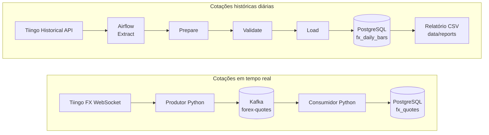

# Forex Hybrid ETL

Pipeline de Engenharia de Dados para ingestão, processamento e análise de cotações cambiais, combinando streaming em tempo real e processamento batch.

## Visão geral

O Forex Hybrid ETL é um projecto de portefólio que tem como objectivo desenvolver um pipeline de dados capaz de recolher cotações do mercado cambial, validar e transformar os dados e disponibilizá-los para análise.

O projecto combina duas estratégias de ingestão:

- Streaming: recepção contínua de cotações através de WebSocket.
- Batch: recolha e processamento de dados históricos através de uma API REST.

A implementação será desenvolvida progressivamente, com foco na qualidade dos dados, na automatização dos processos, na tolerância a falhas e na reprodutibilidade das execuções.

## Objectivos

- Implementar ingestão de dados cambiais em tempo real.
- Desenvolver um processo batch para recolha de dados históricos.
- Aplicar técnicas de validação, normalização e deduplicação.
- Integrar Apache Kafka para processamento de eventos.
- Utilizar PostgreSQL para persistência dos dados.
- Orquestrar tarefas batch com Apache Airflow.
- Criar transformações analíticas para estudar o comportamento do par EUR/USD.
- Aplicar testes automatizados e boas práticas de desenvolvimento.

## Conteúdo

- [Arquitetura](#arquitetura)
- [O que já construí](#o-que-já-construí)
- [Tecnologias e portas](#tecnologias-e-portas)
- [Pré-requisitos](#pré-requisitos)
- [Configuração local](#configuração-local)
- [Base de dados e migrações](#base-de-dados-e-migrações)
- [Executar o pipeline em tempo real](#executar-o-pipeline-em-tempo-real)
- [Airflow e histórico diário](#airflow-e-histórico-diário)
- [Relatórios](#relatórios)
- [Decisões técnicas e limites conhecidos](#decisões-técnicas-e-limites-conhecidos)
- [Testes](#testes)
- [Estrutura do projeto](#estrutura-do-projeto)
- [Acompanhamento do projeto](#acompanhamento-do-projeto)

## Arquitetura



Separação de dados em duas tabelas: `fx_quotes` guardar os ticks em tempo real e
`fx_daily_bars` guardar as velas históricas OHLC. A base `airflow` é usada apenas
para os metadados do orquestrador; os dados Forex ficam na base `forex`.

### Fluxo em tempo real

O produtor recebe mensagens do WebSocket da Tiingo, normaliza as cotações e
publica-as no tópico `forex-quotes`. O consumidor valida cada mensagem e grava
os dados no PostgreSQL antes de confirmar o respetivo offset no Kafka.

### Fluxo histórico

A DAG `tiingo_fx_historical` extrai as velas, guarda a resposta original,
prepara e valida um CSV de staging, carrega os dados com UPSERT e cria um
relatório resumido. Está agendada diariamente para as 00:00 UTC. Por
predefinição, consulta os três dias completos anteriores; numa execução manual,
posso indicar as duas datas do intervalo.

Também criei a DAG tutorial `airflow_primeira_dag` para aprender a acompanhar
execuções e tarefas pela interface do Airflow.

Tiingo pode não devolver uma vela para cada dia pedido. Por isso, o número de
registos carregados pode ser inferior ao número de dias no intervalo.

## O que já foi construído

- Produtor WebSocket Tiingo que normaliza cotações e publica no tópico Kafka
  `forex-quotes`.
- Consumidor Kafka com validação, persistência idempotente em `fx_quotes` e
  confirmação do offset somente depois do processamento.
- Extração de velas históricas Tiingo, preservação da resposta JSON bruta e
  preparação e validação de CSV de staging.
- Carga histórica com UPSERT em `fx_daily_bars`, pela chave
  `(source, symbol, event_time)`.
- Airflow 3.3.2 com `LocalExecutor` e duas DAGs: uma de aprendizagem e outra
  para a ingestão histórica diária.
- View PostgreSQL `v_fx_daily_analysis` e migração SQL versionada.
- View semanal `v_fx_weekly_ohlc`, que agrega as velas diárias por semana UTC.
- View mensal `v_fx_monthly_ohlc`, que agrega as velas diárias por mês UTC.
- View `v_fx_quote_spread` para calcular o spread de ticks que têm bid e ask.
- Relatório CSV com contagem de velas e variações percentuais.
- **45 testes unitários aprovados** na última execução.

## Tecnologias e portas

| Componente | Versão/serviço | Endereço local |
|---|---|---|
| PostgreSQL | `postgres:16-alpine` | `127.0.0.1:5433` |
| Kafka | `confluentinc/cp-kafka:7.6.1` | `localhost:9092` |
| Kafka UI | `provectuslabs/kafka-ui:v0.7.2` | `http://localhost:8080` |
| Airflow | `apache/airflow:3.3.2` | `http://localhost:8081` |
| Python | ambiente local do projeto | 3.11 recomendado |

Para ligar o pgAdmin ao PostgreSQL local, uso host `127.0.0.1`, porta `5433` e
base `forex`. Dentro da rede Docker, os containers usam o host `postgres` e a
porta `5432`. A base `airflow` guarda os metadados do Airflow, não as cotações.

## Pré-requisitos

- Windows com Docker Desktop e Docker Compose.
- Python 3.11 para executar os testes e os processos de tempo real no host.
- Uma conta Tiingo com token e acesso aos produtos Forex que pretendo usar.
- Opcional: pgAdmin ou outro cliente PostgreSQL.

## Configuração local

1. Clono o repositório e abro o PowerShell na pasta do projeto.
2. Crio o ficheiro local de variáveis de ambiente:

   ```powershell
   Copy-Item .env.example .env
   notepad .env
   ```

3. Preencho `TIINGO_API_TOKEN` e defino valores locais para
   `POSTGRES_PASSWORD`, `AIRFLOW_FERNET_KEY`, `AIRFLOW_JWT_SECRET` e
   `AIRFLOW_ADMIN_PASSWORD`. O ficheiro `.env` contém a configuração da minha
   máquina e está excluído do Git.

   Para gerar as chaves Airflow com a imagem usada pelo projeto:

   ```powershell
   docker run --rm apache/airflow:3.3.2 python -c "from cryptography.fernet import Fernet; print(Fernet.generate_key().decode())"
   docker run --rm apache/airflow:3.3.2 python -c "import secrets; print(secrets.token_urlsafe(32))"
   ```

   O primeiro comando gera `AIRFLOW_FERNET_KEY`; o segundo gera
   `AIRFLOW_JWT_SECRET`. Defino palavras-passe diferentes para PostgreSQL e
   para o utilizador administrador do Airflow.

4. Crio e ativo o ambiente Python:

   ```powershell
   python -m venv .venv
   .\.venv\Scripts\Activate.ps1
   python -m pip install --upgrade pip
   pip install -r requirements.txt
   ```

5. Valido a configuração do Compose:

   ```powershell
   docker compose config --quiet
   ```

6. Inicio os serviços Docker:

   ```powershell
   docker compose up airflow-init
   docker compose up -d
   docker compose ps
   ```

   Espero até o PostgreSQL ficar `healthy` e os serviços Airflow estarem ativos.
   A interface do Airflow fica em `http://localhost:8081`; uso os valores locais
   de `AIRFLOW_ADMIN_USERNAME` e `AIRFLOW_ADMIN_PASSWORD` para entrar.

O ficheiro `.env.example` contém os nomes das variáveis necessários. Antes de
iniciar os serviços, preencho os valores no meu `.env` local.

## Base de dados e migrações

Na primeira configuração, aplico os scripts à base `forex` pela seguinte ordem:

1. `sql/schema.sql` — tabela de cotações em tempo real `fx_quotes`.
2. `sql/migrations/001_add_quote_price_fields.sql` — colunas tipadas das
   cotações em tempo real.
3. `sql/migrations/002_create_fx_daily_bars.sql` — tabela histórica.
4. `sql/migrations/003_create_fx_daily_analysis_view.sql` — view analítica.
5. `sql/migrations/004_create_fx_weekly_ohlc_view.sql` — agregação OHLC semanal.
6. `sql/migrations/005_create_fx_quote_spread_view.sql` — spread das cotações.
7. `sql/migrations/006_create_fx_daily_returns_volatility_view.sql` — retornos e volatilidade.
8. `sql/migrations/007_create_fx_monthly_ohlc_view.sql` — agregação OHLC mensal.

Mantenho os scripts SQL no repositório, mas ainda aplico as migrações
manualmente no Query Tool do pgAdmin. A migração da view usa
`CREATE OR REPLACE VIEW` e pode ser executada novamente para atualizar a sua
definição.

Para repetir os controlos de qualidade, executo `sql/quality_checks.sql` no
Query Tool ligado à base `forex`. O script apenas consulta as tabelas e devolve
uma linha por verificação, com contagem de ocorrências e até dez exemplos. Os
controlos OHLC, bid/ask e chaves duplicadas são apresentados como erros. As
lacunas de calendário são apresentadas para revisão, porque fins de semana e
feriados podem explicar a ausência de velas.

## Executar o pipeline em tempo real

Com Kafka e PostgreSQL ativos, abro **dois terminais PowerShell** na raiz do
projeto, ativo o ambiente `.venv` em ambos e executo:

Terminal 1 — consumidor:

```powershell
python -m src.consumers.forex_consumer
```

Terminal 2 — produtor:

```powershell
python -m src.producers.tiingo_ws_producer
```

O produtor lê `TIINGO_API_TOKEN` e `FOREX_SYMBOL` do ambiente. O consumidor
valida as mensagens Kafka e grava as cotações em `fx_quotes`. Para parar os
processos, uso `Ctrl+C`.

## Airflow e histórico diário

Abro `http://localhost:8081`, entro com as credenciais administrativas locais e
procuro `tiingo_fx_historical`. Pela interface, posso acionar uma execução
manual ou acompanhar o agendamento diário.

Parâmetros de execução manual:

- `symbol`: símbolo de seis letras, predefinido como `EURUSD`.
- `start_date` e `end_date`: preencho **ambos** no formato `AAAA-MM-DD` para
  escolher um intervalo inclusivo. Se deixar ambos vazios, a DAG usa a janela
  automática dos três dias completos anteriores.

As tarefas correm nesta ordem:

1. `extract`: consulta a API histórica Tiingo e guarda JSON em `data/raw`.
2. `prepare`: converte a resposta em CSV canónico em `data/staging`.
3. `validate`: verifica estrutura, datas, duplicados e coerência OHLC.
4. `load`: carrega com UPSERT em `fx_daily_bars`.
5. `generate_report`: consulta o PostgreSQL e escreve o relatório CSV em
   `data/reports`; só corre depois de a carga ter sucesso.

Os ficheiros usam nomes com timestamp para preservar os resultados de cada
execução. Mantenho os dados gerados localmente nas pastas `data/raw`,
`data/staging` e `data/reports`.

## Relatórios

Os relatórios criados pela DAG ficam em `data/reports`. Cada CSV contém o
símbolo, as datas pedidas e disponíveis, o número de velas, o número de
comparações com fecho anterior e as variações média, mínima e máxima em
percentagem.

Também consulto a view analítica no pgAdmin:

```sql
SELECT
    symbol,
    data_utc,
    open,
    high,
    low,
    close,
    previous_close,
    variacao_desde_fecho_anterior_pct
FROM v_fx_daily_analysis
WHERE source = 'tiingo'
  AND symbol = 'EURUSD'
ORDER BY event_time;
```

Para consultar as velas semanais agregadas:

```sql
SELECT
    symbol,
    week_start_utc,
    first_bar_date_utc,
    last_bar_date_utc,
    open,
    high,
    low,
    close,
    daily_bar_count
FROM v_fx_weekly_ohlc
WHERE source = 'tiingo'
  AND symbol = 'EURUSD'
ORDER BY week_start_utc;
```

As semanas começam à segunda-feira, em UTC. A abertura é a abertura da primeira
vela diária disponível; o máximo e o mínimo são os extremos da semana; o fecho
é o fecho da última vela disponível. `daily_bar_count` permite ver quantas
velas diárias entraram em cada agregado. Uma semana ainda em curso aparece como
parcial.

Para consultar as velas mensais agregadas:

```sql
SELECT
    symbol,
    month_start_utc,
    first_bar_date_utc,
    last_bar_date_utc,
    open,
    high,
    low,
    close,
    daily_bar_count
FROM v_fx_monthly_ohlc
WHERE source = 'tiingo'
  AND symbol = 'EURUSD'
ORDER BY month_start_utc;
```

O mês começa no primeiro dia do mês em UTC. A abertura é a abertura da primeira
vela diária disponível; o máximo e o mínimo são os extremos das velas do mês; o
fecho é o fecho da última vela disponível. `daily_bar_count` mostra quantas
velas entraram no agregado. O mês atual representa apenas os dados disponíveis
até ao momento.

Para analisar o spread das cotações em tempo real:

```sql
SELECT
    symbol,
    event_time,
    bid_price,
    ask_price,
    spread,
    spread_pct_of_mid,
    is_valid_spread
FROM v_fx_quote_spread
WHERE source = 'tiingo'
  AND symbol = 'EURUSD'
ORDER BY event_time;
```

O spread é `ask_price - bid_price`, expresso na mesma unidade dos preços; não o
converto para pips porque a escala depende do par cambial. A view marca como
inválido um spread sem bid/ask ou com ask inferior ao bid. Nesses casos, o
spread calculado fica vazio, preservando a indicação da qualidade da cotação.

Para consultar os retornos diários e a volatilidade móvel:

```sql
SELECT
    symbol,
    data_utc,
    close,
    previous_close,
    daily_return_pct,
    returns_in_5_observation_window,
    volatility_5_returns_pct
FROM v_fx_daily_returns_volatility
WHERE source = 'tiingo'
  AND symbol = 'EURUSD'
ORDER BY event_time;
```

O retorno diário compara o fecho com o fecho anterior. A volatilidade é o desvio
padrão amostral dos últimos cinco retornos observados, expresso em pontos
percentuais e sem anualização. Só é apresentado quando existem cinco retornos
na janela; antes disso, fica vazio. Como esta demonstração contém poucas velas,
é normal que a volatilidade apareça apenas na última linha.

## Decisões técnicas e limites conhecidos

### Decisões técnicas

- Separei os ticks em tempo real (`fx_quotes`) das velas históricas diárias
  (`fx_daily_bars`), porque têm formatos, ritmos de chegada e chaves diferentes.
- Trato os timestamps como instantes com fuso horário e uso UTC nas consultas
  diárias, semanais e mensais. As semanas começam à segunda-feira.
- Guardo a resposta histórica original em JSON e uso CSV como formato
  intermédio de staging. No Airflow, o XCom transporta os caminhos dos ficheiros,
  não o conteúdo completo dos dados.
- Na tabela histórica, a chave `(source, symbol, event_time)` permite reexecutar
  cargas: a mesma vela actualiza os valores existentes em vez de criar outra.
- No fluxo realtime, gravo primeiro no PostgreSQL e só depois confirmo o offset
  Kafka. A restrição de unicidade considera `(source, symbol, event_time,
  raw_data)`, pelo que elimina a repetição da mesma mensagem, não necessariamente
  ticks distintos com o mesmo timestamp.
- As validações confirmam preços positivos e coerência OHLC antes da carga; as
  restrições PostgreSQL também protegem esses valores na tabela histórica.
- A volatilidade apresentada é o desvio padrão amostral dos últimos cinco
  retornos observados, sem anualização. O spread permanece na unidade do preço,
  sem conversão para pips.

### Limites conhecidos

- A integração depende da Tiingo e está centrada no símbolo EURUSD. Cobertura,
  disponibilidade e dados devolvidos dependem da fonte; uma data pedida pode
  não ter uma vela.
- A verificação de completude conta dias de segunda a sexta-feira, mas não usa
  um calendário cambial de feriados. As lacunas nesses dias são indicações para
  revisão, não prova automática de dados em falta.
- Os testes automatizados usam dados sintéticos e serviços locais. Não testam
  uma ligação real ao WebSocket ou à API Tiingo.
- O teste Kafka publica pelo callback do produtor e consome do broker isolado;
  valida a mensagem com a função do consumidor e grava-a no PostgreSQL de teste.
  Não inicia o processo contínuo do consumidor nem verifica nesse teste a
  confirmação real do offset; esse comportamento tem cobertura unitária.
- O teste Airflow de recuperação executa a DAG, mas substitui as funções de
  extracção, staging, validação, carga e relatório. A integração histórica
  JSON → staging → PostgreSQL é testada separadamente; ainda não há um teste
  automatizado que execute a DAG completa contra a API e o PostgreSQL.
- O Compose principal é local, com um broker Kafka e `LocalExecutor` no
  Airflow. Não está preparado para alta disponibilidade nem para implantação
  distribuída.
- As migrações PostgreSQL são aplicadas manualmente; não há ainda um processo
  automatizado de versionamento e aplicação no arranque.
- A extração e a carga da DAG têm dois retries com intervalo de um minuto. As
  restantes tarefas não têm retries explícitos, e ainda não há alertas
  automáticos para falhas.

## Testes

Executo os testes unitários a partir da raiz, com o ambiente virtual ativo:

```powershell
python -m unittest discover -s tests -v
```

Os testes cobrem normalização, validação do produtor e consumidor, extração
histórica, staging, carga e geração do relatório. Na última execução, os
**45 testes unitários passaram**. Também tenho testes de integração separados,
que executam o carregador contra um PostgreSQL descartável.

### Teste de integração PostgreSQL

Também preparo um PostgreSQL isolado e descartável para testar o percurso
JSON → staging CSV → carregador → base de dados. O teste não usa a base `forex`
nem altera os dados do ambiente de desenvolvimento.

Num terminal PowerShell, defino uma palavra-passe temporária para o container
de teste e inicio apenas esse serviço:

```powershell
$env:POSTGRES_TEST_PASSWORD = [guid]::NewGuid().ToString("N")
docker compose -p forex-integration-test -f docker-compose.integration.yml up -d
```

Depois indico ao teste os parâmetros desse PostgreSQL isolado e executo os
testes de integração:

```powershell
$env:RUN_POSTGRES_INTEGRATION = "1"
$env:TEST_POSTGRES_HOST = "127.0.0.1"
$env:TEST_POSTGRES_PORT = "55432"
$env:TEST_POSTGRES_DB = "forex_integration_test"
$env:TEST_POSTGRES_USER = "forex_test"
$env:TEST_POSTGRES_PASSWORD = $env:POSTGRES_TEST_PASSWORD
python -m unittest discover -s tests\integration -v
```

Os cinco testes de integração históricos verificam a persistência e o UPSERT ao
reprocessar o mesmo CSV, a rejeição de OHLC inválido antes de gravar, a
consistência, a completude e a unicidade em dois intervalos, a falha explícita
quando o PostgreSQL não está disponível e a propagação de um erro HTTP 503 da
API simulada localmente. A completude considera dias úteis de segunda a
sexta-feira; como ainda não existe um calendário de feriados, lacunas nesses
dias ficam sinalizadas para revisão, não são automaticamente classificadas
como erro. Os testes recusam-se a executar operações de escrita se a base não
se chamar exatamente `forex_integration_test`. Depois de terminar, removo o
container e a base descartável:

```powershell
docker compose -p forex-integration-test -f docker-compose.integration.yml down
```

O serviço de teste não tem volume persistente. Se o terminal fechar antes da
limpeza, executo o comando `down` acima no mesmo projeto Compose.

### Teste do percurso realtime

O Compose de integração também inicia um Kafka isolado, sem reutilizar o
broker nem o tópico do ambiente principal. Com os serviços de teste ativos,
defino o endereço do broker e corro os testes de integração:

```powershell
$env:KAFKA_TEST_BOOTSTRAP_SERVERS = "127.0.0.1:19092"
python -m unittest discover -s tests\integration -v
```

O teste realtime publica uma cotação sintética pelo produtor, consome-a do
tópico de teste, valida-a com o consumidor e guarda-a no PostgreSQL descartável.
Confirma também que o UPSERT não cria duplicações. Não é feita qualquer chamada
à Tiingo. Ao terminar os testes, removo o conjunto de serviços isolados:

```powershell
docker compose -p forex-integration-test -f docker-compose.integration.yml down
```

O percurso realtime e a DAG histórica são pipelines independentes. Por isso,
verifico o Kafka com PostgreSQL no teste acima e a recuperação da DAG com o
Airflow e metadados SQLite temporários, no comando seguinte.

### Teste de retry e recuperação da DAG

Também testo a DAG `tiingo_fx_historical` no container Airflow, sem chamar a
Tiingo nem escrever na base Forex. O teste substitui as funções das tarefas,
simula uma falha transitória na primeira tentativa de carga e confirma que o
retry conclui a execução sem repetir as tarefas anteriores nem o relatório.
Os metadados desta execução ficam numa base SQLite temporária:

```powershell
docker compose run --rm --no-deps --entrypoint bash `
  -e AIRFLOW_HOME=/tmp/airflow-recovery-test `
  -e AIRFLOW__CORE__DAGS_FOLDER=/opt/airflow/dags `
  -e AIRFLOW__DATABASE__SQL_ALCHEMY_CONN=sqlite:////tmp/airflow-recovery-test/airflow.db `
  -e AIRFLOW__LOGGING__LOGGING_LEVEL=ERROR `
  airflow-scheduler `
  -c "airflow db migrate && python -m unittest discover -s /opt/airflow/tests -v"
```

O comando cria um container de teste temporário e remove-o ao terminar. A
primeira falha aparece no log de propósito; o resultado esperado são dois
testes aprovados.

## Estrutura do projeto

```text
airflow/dags/       DAG tutorial e DAG histórica
data/raw/           respostas JSON da API (ficheiros locais)
data/staging/       CSVs intermédios (ficheiros locais)
data/reports/       relatórios CSV (ficheiros locais)
sql/                schema e migrações PostgreSQL
src/                produtor, consumidor, extractores, staging, loaders e reports
tests/              testes unitários
tests/integration/  testes históricos e realtime com serviços isolados
tests/airflow/      testes de retry e recuperação da DAG
docker-compose.yml  Kafka, PostgreSQL e Airflow
docker-compose.integration.yml Kafka e PostgreSQL descartáveis para integração
.env.example        modelo de variáveis para configuração local
requirements.txt    dependências Python da aplicação
requirements-lock.txt
                    lock atual a rever antes de usar numa instalação limpa
```

## Acompanhamento do projeto

### Concluído

- [x] Ambiente Docker com Kafka, PostgreSQL e Airflow local.
- [x] Fluxo em tempo real Tiingo → Kafka → PostgreSQL (`fx_quotes`).
- [x] Extração histórica, staging, validação e UPSERT (`fx_daily_bars`).
- [x] DAG manual e agendamento diário às 00:00 UTC, com janela móvel.
- [x] Consulta analítica e view `v_fx_daily_analysis`.
- [x] Agregação OHLC semanal em `v_fx_weekly_ohlc`.
- [x] Agregação OHLC mensal em `v_fx_monthly_ohlc`.
- [x] Cálculo do spread bid/ask em `v_fx_quote_spread`.
- [x] Retorno diário e volatilidade móvel de cinco retornos em
  `v_fx_daily_returns_volatility`.
- [x] Diagnóstico SQL reutilizável de preços, duplicações e lacunas em
  `sql/quality_checks.sql`.
- [x] Relatório CSV dependente da carga e guardado em `data/reports`.
- [x] Testes unitários locais: 45 aprovados na última execução.
- [x] Testes de integração: 6 aprovados (5 históricos e 1 realtime).
- [x] Testar retry e recuperação da DAG com metadados Airflow isolados.

### Fase 8 — Testes e qualidade dos dados

- [x] Expandir testes unitários para fusos horários, timestamps equivalentes,
  preços zero/negativos, resposta vazia e timeout da API.
- [x] Criar testes de integração JSON → staging → PostgreSQL, isolados da base real.
- [x] Verificar falhas controladas do PostgreSQL e da API histórica.
- [x] Validar OHLC, unicidade e dias úteis em intervalos completos e incompletos.
- [x] Testar reexecução e recuperação da DAG após falha transitória.
- [x] Validar separadamente o fluxo realtime com Kafka/PostgreSQL e os retries
  da DAG no Airflow.
- [x] Documentar limites conhecidos e decisões técnicas.

### Melhorias a desenvolver

- [ ] Aplicar a análise OHLC mensal a outros símbolos e períodos.
- [ ] Automatizar o controlo e a aplicação de migrações PostgreSQL.
- [ ] Integrar a execução completa da DAG com os testes de carga e PostgreSQL.
- [ ] Configurar alertas para falhas e monitorização das execuções agendadas.
- [ ] Rever a política de retries das tarefas da DAG.
- [ ] Preparar uma configuração para executar o projeto fora da máquina local.
