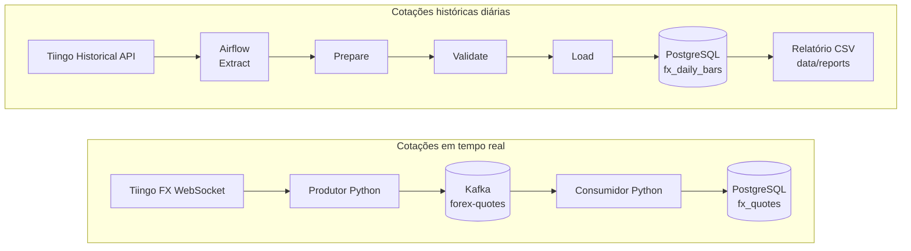

# Forex Hybrid ETL

Estou a construir este projeto para aprender e implementar um pipeline de dados
Forex com a Tiingo. Combinei duas formas de ingestão: cotações em tempo real e
velas históricas diárias, usando Python, Kafka, PostgreSQL e Apache Airflow.

Neste momento, os dois fluxos estão implementados e testados localmente. O
histórico é carregado diariamente, analisado no PostgreSQL e exportado para CSV.
No fim deste README mantenho o ponto de situação e os próximos objetivos.

## Conteúdo

- [Arquitetura](#arquitetura)
- [O que já construí](#o-que-já-construí)
- [Tecnologias e portas](#tecnologias-e-portas)
- [Pré-requisitos](#pré-requisitos)
- [Configuração local](#configuração-local)
- [Base de dados e migrações](#base-de-dados-e-migrações)
- [Executar o pipeline em tempo real](#executar-o-pipeline-em-tempo-real)
- [Airflow e histórico diário](#airflow-e-histórico-diário)
- [Relatórios](#relatórios)
- [Testes](#testes)
- [Estrutura do projeto](#estrutura-do-projeto)
- [Acompanhamento do projeto](#acompanhamento-do-projeto)

## Arquitetura



Separei os dados em duas tabelas: `fx_quotes` guarda os ticks em tempo real e
`fx_daily_bars` guarda as velas históricas OHLC. A base `airflow` é usada apenas
para os metadados do orquestrador; os dados Forex ficam na base `forex`.

### Fluxo em tempo real

O produtor recebe mensagens do WebSocket da Tiingo, normaliza as cotações e
publica-as no tópico `forex-quotes`. O consumidor valida cada mensagem e grava
os dados no PostgreSQL antes de confirmar o respetivo offset no Kafka.

### Fluxo histórico

A DAG `tiingo_fx_historical` extrai as velas, guarda a resposta original,
prepara e valida um CSV de staging, carrega os dados com UPSERT e cria um
relatório resumido. Está agendada diariamente para as 00:00 UTC. Por
predefinição, consulta os três dias completos anteriores; numa execução manual,
posso indicar as duas datas do intervalo.

Também criei a DAG tutorial `airflow_primeira_dag` para aprender a acompanhar
execuções e tarefas pela interface do Airflow.

Tiingo pode não devolver uma vela para cada dia pedido. Por isso, o número de
registos carregados pode ser inferior ao número de dias no intervalo.

## O que já construí

- Produtor WebSocket Tiingo que normaliza cotações e publica no tópico Kafka
  `forex-quotes`.
- Consumidor Kafka com validação, persistência idempotente em `fx_quotes` e
  confirmação do offset somente depois do processamento.
- Extração de velas históricas Tiingo, preservação da resposta JSON bruta e
  preparação e validação de CSV de staging.
- Carga histórica com UPSERT em `fx_daily_bars`, pela chave
  `(source, symbol, event_time)`.
- Airflow 3.3.2 com `LocalExecutor` e duas DAGs: uma de aprendizagem e outra
  para a ingestão histórica diária.
- View PostgreSQL `v_fx_daily_analysis` e migração SQL versionada.
- Relatório CSV com contagem de velas e variações percentuais.
- **38 testes unitários aprovados** na última execução.

## Tecnologias e portas

| Componente | Versão/serviço | Endereço local |
|---|---|---|
| PostgreSQL | `postgres:16-alpine` | `127.0.0.1:5433` |
| Kafka | `confluentinc/cp-kafka:7.6.1` | `localhost:9092` |
| Kafka UI | `provectuslabs/kafka-ui:v0.7.2` | `http://localhost:8080` |
| Airflow | `apache/airflow:3.3.2` | `http://localhost:8081` |
| Python | ambiente local do projeto | 3.11 recomendado |

Para ligar o pgAdmin ao PostgreSQL local, uso host `127.0.0.1`, porta `5433` e
base `forex`. Dentro da rede Docker, os containers usam o host `postgres` e a
porta `5432`. A base `airflow` guarda os metadados do Airflow, não as cotações.

## Pré-requisitos

- Windows com Docker Desktop e Docker Compose.
- Python 3.11 para executar os testes e os processos de tempo real no host.
- Uma conta Tiingo com token e acesso aos produtos Forex que pretendo usar.
- Opcional: pgAdmin ou outro cliente PostgreSQL.

## Configuração local

1. Clono o repositório e abro o PowerShell na pasta do projeto.
2. Crio o ficheiro local de variáveis de ambiente:

   ```powershell
   Copy-Item .env.example .env
   notepad .env
   ```

3. Preencho `TIINGO_API_TOKEN` e defino valores locais para
   `POSTGRES_PASSWORD`, `AIRFLOW_FERNET_KEY`, `AIRFLOW_JWT_SECRET` e
   `AIRFLOW_ADMIN_PASSWORD`. O ficheiro `.env` contém a configuração da minha
   máquina e está excluído do Git.

   Para gerar as chaves Airflow com a imagem usada pelo projeto:

   ```powershell
   docker run --rm apache/airflow:3.3.2 python -c "from cryptography.fernet import Fernet; print(Fernet.generate_key().decode())"
   docker run --rm apache/airflow:3.3.2 python -c "import secrets; print(secrets.token_urlsafe(32))"
   ```

   O primeiro comando gera `AIRFLOW_FERNET_KEY`; o segundo gera
   `AIRFLOW_JWT_SECRET`. Defino palavras-passe diferentes para PostgreSQL e
   para o utilizador administrador do Airflow.

4. Crio e ativo o ambiente Python:

   ```powershell
   python -m venv .venv
   .\.venv\Scripts\Activate.ps1
   python -m pip install --upgrade pip
   pip install -r requirements.txt
   ```

5. Valido a configuração do Compose:

   ```powershell
   docker compose config --quiet
   ```

6. Inicio os serviços Docker:

   ```powershell
   docker compose up airflow-init
   docker compose up -d
   docker compose ps
   ```

   Espero até o PostgreSQL ficar `healthy` e os serviços Airflow estarem ativos.
   A interface do Airflow fica em `http://localhost:8081`; uso os valores locais
   de `AIRFLOW_ADMIN_USERNAME` e `AIRFLOW_ADMIN_PASSWORD` para entrar.

O ficheiro `.env.example` contém os nomes das variáveis necessários. Antes de
iniciar os serviços, preencho os valores no meu `.env` local.

## Base de dados e migrações

Na primeira configuração, aplico os scripts à base `forex` pela seguinte ordem:

1. `sql/schema.sql` — tabela de cotações em tempo real `fx_quotes`.
2. `sql/migrations/001_add_quote_price_fields.sql` — colunas tipadas das
   cotações em tempo real.
3. `sql/migrations/002_create_fx_daily_bars.sql` — tabela histórica.
4. `sql/migrations/003_create_fx_daily_analysis_view.sql` — view analítica.

Mantenho os scripts SQL no repositório, mas ainda aplico as migrações
manualmente no Query Tool do pgAdmin. A migração da view usa
`CREATE OR REPLACE VIEW` e pode ser executada novamente para atualizar a sua
definição.

## Executar o pipeline em tempo real

Com Kafka e PostgreSQL ativos, abro **dois terminais PowerShell** na raiz do
projeto, ativo o ambiente `.venv` em ambos e executo:

Terminal 1 — consumidor:

```powershell
python -m src.consumers.forex_consumer
```

Terminal 2 — produtor:

```powershell
python -m src.producers.tiingo_ws_producer
```

O produtor lê `TIINGO_API_TOKEN` e `FOREX_SYMBOL` do ambiente. O consumidor
valida as mensagens Kafka e grava as cotações em `fx_quotes`. Para parar os
processos, uso `Ctrl+C`.

## Airflow e histórico diário

Abro `http://localhost:8081`, entro com as credenciais administrativas locais e
procuro `tiingo_fx_historical`. Pela interface, posso acionar uma execução
manual ou acompanhar o agendamento diário.

Parâmetros de execução manual:

- `symbol`: símbolo de seis letras, predefinido como `EURUSD`.
- `start_date` e `end_date`: preencho **ambos** no formato `AAAA-MM-DD` para
  escolher um intervalo inclusivo. Se deixar ambos vazios, a DAG usa a janela
  automática dos três dias completos anteriores.

As tarefas correm nesta ordem:

1. `extract`: consulta a API histórica Tiingo e guarda JSON em `data/raw`.
2. `prepare`: converte a resposta em CSV canónico em `data/staging`.
3. `validate`: verifica estrutura, datas, duplicados e coerência OHLC.
4. `load`: carrega com UPSERT em `fx_daily_bars`.
5. `generate_report`: consulta o PostgreSQL e escreve o relatório CSV em
   `data/reports`; só corre depois de a carga ter sucesso.

Os ficheiros usam nomes com timestamp para preservar os resultados de cada
execução. Mantenho os dados gerados localmente nas pastas `data/raw`,
`data/staging` e `data/reports`.

## Relatórios

Os relatórios criados pela DAG ficam em `data/reports`. Cada CSV contém o
símbolo, as datas pedidas e disponíveis, o número de velas, o número de
comparações com fecho anterior e as variações média, mínima e máxima em
percentagem.

Também consulto a view analítica no pgAdmin:

```sql
SELECT
    symbol,
    data_utc,
    open,
    high,
    low,
    close,
    previous_close,
    variacao_desde_fecho_anterior_pct
FROM v_fx_daily_analysis
WHERE source = 'tiingo'
  AND symbol = 'EURUSD'
ORDER BY event_time;
```

## Testes

Executo os testes unitários a partir da raiz, com o ambiente virtual ativo:

```powershell
python -m unittest discover -s tests -v
```

Os testes cobrem normalização, validação do produtor e consumidor, extração
histórica, staging, carga e geração do relatório. Na última execução, os
**38 testes passaram**. Ainda quero configurar a execução automática dos testes
no GitHub Actions.

## Estrutura do projeto

```text
airflow/dags/       DAG tutorial e DAG histórica
data/raw/           respostas JSON da API (ficheiros locais)
data/staging/       CSVs intermédios (ficheiros locais)
data/reports/       relatórios CSV (ficheiros locais)
sql/                schema e migrações PostgreSQL
src/                produtor, consumidor, extractores, staging, loaders e reports
tests/              testes unitários
docker-compose.yml  Kafka, PostgreSQL e Airflow
.env.example        modelo de variáveis para configuração local
requirements.txt    dependências Python da aplicação
requirements-lock.txt
                    lock atual a rever antes de usar numa instalação limpa
```

## Acompanhamento do projeto

### O que já concluí

- [x] Ambiente Docker com Kafka, PostgreSQL e Airflow local.
- [x] Fluxo em tempo real Tiingo → Kafka → PostgreSQL (`fx_quotes`).
- [x] Extração histórica, staging, validação e UPSERT (`fx_daily_bars`).
- [x] DAG manual e agendamento diário às 00:00 UTC, com janela móvel.
- [x] Consulta analítica e view `v_fx_daily_analysis`.
- [x] Relatório CSV dependente da carga e guardado em `data/reports`.
- [x] Testes unitários locais: 38 aprovados na última execução.

### Próximos passos para publicar no GitHub

- [ ] Rever as dependências e substituir `requirements-lock.txt` por um lock
  reproduzível e limitado às dependências deste projeto.
- [ ] Configurar GitHub Actions para executar os testes em cada pull request.
- [ ] Escolher uma licença, caso decida tornar o repositório público.
- [ ] Criar o repositório remoto e publicar a primeira versão.

### Melhorias que quero desenvolver

- [ ] Automatizar o controlo e a aplicação de migrações PostgreSQL.
- [ ] Adicionar testes de integração da DAG, PostgreSQL e Kafka em ambiente
  descartável.
- [ ] Configurar alertas para falhas e monitorização das execuções agendadas.
- [ ] Rever a política de retries das tarefas da DAG.
- [ ] Preparar uma configuração para executar o projeto fora da máquina local.
